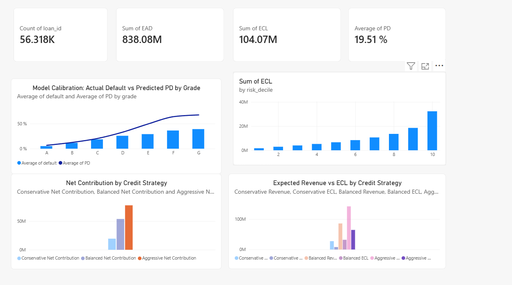

Credit Risk & Portfolio Profitability Analysis

Project Overview

This project develops an end-to-end credit risk and portfolio profitability analysis using the LendingClub public loan dataset.

The objective is to estimate borrower default risk, calculate Expected Credit Loss (ECL), analyze portfolio risk segments, and simulate different credit approval strategies.

Tools & Technologies

Python (Pandas, NumPy, Scikit-learn)

Logistic Regression

Probability Calibration (Platt Scaling)

SQL (DuckDB)

Power BI

Jupyter Notebook

Project Structure

notebooks/ – Credit risk modelling and portfolio analysis

sql/ – SQL queries and portfolio segmentation

powerbi/ – Interactive Power BI dashboard

images/ – Dashboard screenshots

Methodology

1. Credit Risk Modelling

Developed a Logistic Regression baseline model.

Used a temporal train/test split.

Evaluated model performance using ROC-AUC and Brier Score.

Tested Platt Scaling for probability calibration.

2. Expected Credit Loss (ECL)

ECL was estimated using:

ECL = PD × LGD × EAD

Historical LGD was estimated using principal repayments and net recoveries. Original loan amount was used as a proxy for EAD.

3. Portfolio Risk Segmentation

Loans were grouped into ten risk deciles based on predicted Probability of Default (PD).

The highest-risk 20% of loans accounted for approximately 48.9% of total estimated ECL.

4. Credit Strategy Simulation

Three approval strategies were evaluated:

Conservative: PD ≤ 10%

Balanced: PD ≤ 20%

Aggressive: PD ≤ 35%

The analysis compared approval rates, expected interest revenue, expected credit losses, and simplified expected net contribution.

Key Findings

Test-set ROC-AUC: approximately 0.6795.

Historical LGD estimate: approximately 58.09%.

Total estimated ECL: approximately $104.07 million.

Portfolio ECL rate: approximately 12.42%.

The Aggressive strategy generated the highest total expected net contribution, but also significantly higher expected credit losses.

The Balanced strategy represents a potential compromise between portfolio growth and credit risk, depending on the institution's risk appetite.

Limitations

This project is an educational proof of concept and is not a production-ready credit risk model or a full IFRS 9 implementation.

Important limitations include:

The modelling sample includes only loans with terminal outcomes (Fully Paid, Charged Off, Default).

The 2018 test sample may be affected by loan maturity and selection bias.

Original loan amount is used as a proxy for Exposure at Default.

LGD is based on a simplified historical recovery calculation.

The profitability simulation excludes funding costs, operating expenses, taxes, and other costs.

Future Improvements

Improve probability calibration and out-of-time validation.

Develop more robust EAD and LGD estimates.

Incorporate additional borrower and macroeconomic variables.

Extend profitability analysis with funding and operating costs.

Explore more advanced credit risk models.

Dataset

LendingClub public loan dataset, available through Kaggle.

This repository does not include the original raw dataset.

## Power BI Dashboard

